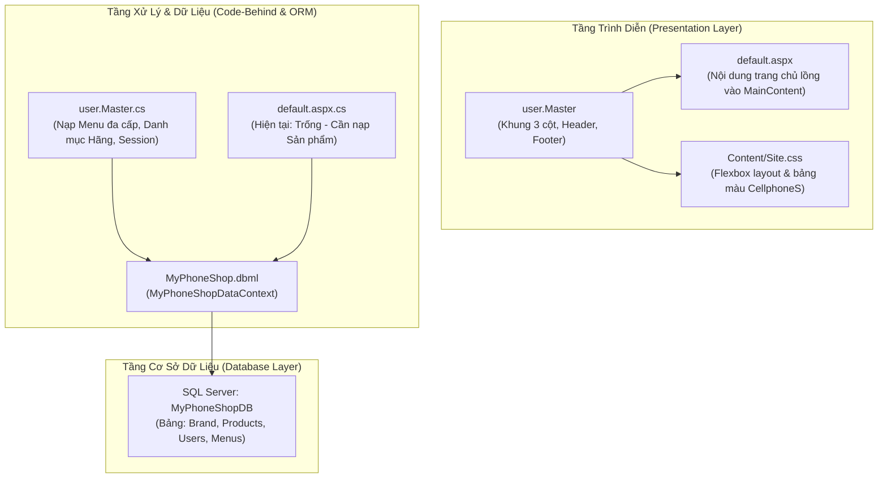

# BÁO CÁO TOÀN DIỆN & ĐÁNH GIÁ CHI TIẾT DỰ ÁN MYPHONESHOP (ASP.NET WEB FORMS)

> **Môn học:** Lập trình Web / Đồ án Web ASP.NET  
> **Dự án:** Hệ thống Website Thương mại Điện tử Bán lẻ Điện thoại - **MyPhoneShop**  
> **Thư mục dự án:** `web-bai2-masterpage`  
> **Nền tảng công nghệ:** ASP.NET Web Forms (.NET Framework 4.8), C#, SQL Server, LINQ to SQL, HTML5/CSS3 Flexbox  
> **Ngày báo cáo:** 19/10/2026  

---

## MỤC LỤC
1. [TỔNG QUAN DỰ ÁN](#1-tổng-quan-dự-án)
2. [NHỮNG GÌ BẠN ĐÃ LÀM ĐƯỢC (ĐÁNH GIÁ MÃ NGUỒN)](#2-những-gì-bạn-đã-làm-được-đánh-giá-mã-nguồn)
3. [NHỮNG GÌ BẠN CHƯA LÀM ĐƯỢC (LỘ TRÌNH CÒN THIẾU)](#3-những-gì-bạn-chưa-làm-được-lộ-trình-còn-thiếu)
4. [CÁC LỖI ĐÃ & ĐANG TIỀM ẨN TRONG PROJECT](#4-các-lỗi-đã--đang-tiềm-ẩn-trong-project)
5. [ĐỀ XUẤT CẢI THIỆN CHUYÊN SÂU (BEST PRACTICES & SECURITY)](#5-đề-xuất-cải-thiện-chuyên-sâu-best-practices--security)
6. [KẾ HOẠCH HÀNH ĐỘNG BƯỚC TIẾP THEO (BÀI 3 CHI TIẾT)](#6-kế-hoạch-hành-động-bước-tiếp-theo-bài-3-chi-tiết)
7. [TỔNG KẾT & CHECKLIST ĐÁNH GIÁ](#7-tổng-kết--checklist-đánh-giá)

---

## 1. TỔNG QUAN DỰ ÁN

### 1.1 Mục tiêu học phần & Bối cảnh đồ án
Dự án **MyPhoneShop** là một ứng dụng web thương mại điện tử hoàn chỉnh theo mô hình **ASP.NET Web Forms** truyền thống nhưng áp dụng các kỹ thuật kiến trúc hiện đại:
- Sử dụng mô hình **O/R Mapping (Object-Relational Mapping)** với **LINQ to SQL (`.dbml`)** thay vì viết các câu lệnh ADO.NET thủ công (`SqlCommand`, `SqlDataReader`).
- Xây dựng bố cục giao diện dùng **Master Page (`.master`)** kết hợp nguyên lý dàn trang 3 cột chuẩn Slide 7 (Chapter 2.3 Layout - Lương Thái Ngọc) và cảm hứng giao diện bán lẻ từ chuỗi CellphoneS.
- Quản lý phiên làm việc (`Session`), bảo mật băm mật khẩu đa lớp (SHA-256 + Salt), và phân quyền hệ thống giữa Người dùng thông thường và Quản trị viên (`Admin`).

### 1.2 Kiến trúc phân tầng hiện tại



### 1.3 Cấu trúc thư mục mã nguồn hiện tại

| Thư mục / Tập tin | Loại file | Vai trò trong dự án |
| :--- | :--- | :--- |
| `user.Master` | Master Page | Bộ khung giao diện 3 cột chuẩn (Header, Navigation Menu, Sidebar trái, Sidebar phải, Footer). |
| `user.Master.cs` | Code-Behind | Logic nạp menu đa cấp từ CSDL, nạp danh sách hãng, điều hướng Session. |
| `user.Master.designer.cs` | Designer | Khai báo các Web Controls trên Master Page (`rptParentMenus`, `rptMenuBrands`,...). |
| `default.aspx` | Web Form | Trang chủ con, kế thừa `user.Master`, nhận nội dung tại `MainContent`. |
| `default.aspx.cs` | Code-Behind | Xử lý logic nghiệp vụ cho trang chủ (Hiện tại đang để trống). |
| `MyPhoneShop.dbml` | LINQ to SQL | File ánh xạ O/R Mapping giữa các bảng SQL Server và lớp C#. |
| `MyPhoneShop.designer.cs` | Generated | Mã C# tự động sinh của `MyPhoneShopDataContext` và các thực thể (`Product`, `Brand`, `User`, `Menu`). |
| `Web.config` | Config XML | Cấu hình ứng dụng, chuỗi kết nối CSDL, phiên bản .NET Framework. |
| `Script_Create_Menus.sql` | SQL Script | Script khởi tạo bảng `dbo.Menus` đa cấp và dữ liệu mẫu danh mục. |
| `Content/Site.css` | Stylesheet | Toàn bộ định dạng giao diện website (banner đỏ, thẻ sản phẩm, dropdown menu). |

---

## 2. NHỮNG GÌ BẠN ĐÃ LÀM ĐƯỢC (ĐÁNH GIÁ MÃ NGUỒN)

Hiện tại, bạn đã hoàn thành trọn vẹn **Giai đoạn 1 (Bài 1)** và **Giai đoạn 2 (Bài 2)** với chất lượng code tương đối tốt và vượt qua yêu cầu cơ bản ở một số điểm:

### 2.1 Hoàn thành Bài 1: CSDL & Ánh xạ LINQ to SQL
1. **Thiết kế CSDL chuẩn mực (`MyPhoneShopDB`):**
   - Đã tạo các bảng thực thể quan hệ: `Brand` (Thương hiệu), `Products` (Sản phẩm với khóa ngoại liên kết về `Brand`), `Users` (Người dùng & mật khẩu).
   - **Điểm nổi bật (Mở rộng nâng cao):** Bạn đã tạo thêm bảng `dbo.Menus` với cấu trúc đệ quy đa cấp chuẩn công nghiệp (`ID_MN`, `Parent`, `Lable`, `UrlLink`, `OrderKey`). Bảng này cho phép quản trị viên thêm bớt danh mục trên thanh điều hướng mà không cần sửa code giao diện.
2. **Ánh xạ LINQ to SQL thành công (`MyPhoneShop.dbml`):**
   - Đã ánh xạ toàn bộ 4 bảng thành các Class trong C#.
   - Đã thiết lập chuỗi kết nối hợp lệ trong `Web.config`:
     ```xml
     <connectionStrings>
         <add name="MyPhoneShopDBConnectionString" 
              connectionString="Data Source=DESKTOP-21EGL6H\SQLEXPRESS;Initial Catalog=MyPhoneShopDB;Persist Security Info=True;User ID=ah;Password=123;TrustServerCertificate=True" 
              providerName="System.Data.SqlClient" />
     </connectionStrings>
     ```

### 2.2 Hoàn thành Bài 2: Master Page 3 Cột Hiện Đại
1. **Bố cục 3 cột chuẩn Slide 7 (Chapter 2.3 Layout) kết hợp phong cách CellphoneS:**
   - **Top Banner đỏ thương hiệu:** Logo MyPhoneShop, thanh Search to bản nổi bật, nút Đăng nhập / Đăng ký.
   - **Thanh Navigation Menu động:** Sử dụng kỹ thuật lồng `Repeater` (`rptParentMenus` và `rptChildMenus`).
   - **Cột Trái (Sidebar Trái):** Tự động đổ dữ liệu thương hiệu (`rptMenuBrands`) kèm khối lọc giá nhanh.
   - **Cột Giữa (MainContent):** Thẻ `<asp:ContentPlaceHolder ID="MainContent" runat="server">` sẵn sàng đón nhận trang con.
   - **Cột Phải (Sidebar Phải):** Khối "Tin nóng công nghệ" và "Cam kết dịch vụ" tạo độ tin cậy mua sắm.
   - **Footer 4 cột:** Cung cấp thông tin doanh nghiệp, chính sách, tổng đài hỗ trợ và phương thức thanh toán.

2. **Kỹ thuật xử lý Menu đa cấp chống lỗi N+1 Query trong `user.Master.cs`:**
   - Bạn đã tối ưu truy vấn bằng cách đọc toàn bộ Menu vào bộ nhớ đệm `_allActiveMenus` chỉ trong **1 câu truy vấn SQL duy nhất**:
     ```csharp
     _allActiveMenus = db.Menus.OrderBy(m => m.OrderKey).ToList();
     ```
   - Trong sự kiện `rptParentMenus_ItemDataBound`, việc lọc Menu con được thực hiện hoàn toàn trên bộ nhớ RAM bằng LINQ to Objects:
     ```csharp
     var childMenus = _allActiveMenus.Where(m => m.Parent == parentMenu.ID_MN).ToList();
     ```
     > **Đánh giá cao:** Đây là kỹ thuật lập trình tốt, tránh được lỗi N+1 Query (tức không gửi câu lệnh truy vấn xuống SQL Server mỗi khi duyệt một dòng menu cha).

3. **Cơ chế quản lý trạng thái tài khoản qua `Session`:**
   - Trong `Page_Load` của `user.Master.cs`, bạn đã kiểm tra `Session["Username"]`:
     - Nếu chưa đăng nhập: Hiển thị khối `phAnonymous` (Đăng nhập / Đăng ký).
     - Nếu đã đăng nhập: Hiển thị khối `phLoggedIn` (chào tên người dùng, nút Đăng xuất).
     - Kiểm tra quyền Quản trị `Session["Role"] == "Admin"` để ẩn/hiện liên kết `lnkAdmin` tới trang quản trị.

4. **Sử dụng đường dẫn ảo `ResolveUrl` chống vỡ CSS/Link:**
   - Toàn bộ liên kết và nạp CSS đều dùng cú pháp `<%= ResolveUrl("~/Content/Site.css") %>`, đảm bảo khi tạo các trang con trong thư mục con (ví dụ: `/Admin/Products.aspx`) thì giao diện không bao giờ bị lỗi 404 mất định dạng.

---

## 3. NHỮNG GÌ BẠN CHƯA LÀM ĐƯỢC (LỘ TRÌNH CÒN THIẾU)

Dự án hiện đang **dừng lại ở giao diện khung Master Page**. Trang web chưa thể hoạt động như một cửa hàng điện thoại thật sự vì thiếu 6 giai đoạn kỹ thuật tiếp theo:

### 3.1 Chưa làm Giai đoạn 3 (Bài 3): Hiển thị sản phẩm lên `Default.aspx`
- **Tình trạng file `default.aspx`:** Hiện mới chỉ có một khối `<div>` thông báo tĩnh *"🎉 CHÀO MỪNG BẠN ĐẾN VỚI HỆ THỐNG MYPHONESHOP!"*.
- **Thiếu:**
  - Chưa có điều khiển `<asp:Repeater ID="rptProducts" runat="server">`.
  - Chưa thiết kế thẻ sản phẩm (Product Card): Ảnh điện thoại, nhãn hãng, giá hiện tại, giá cũ, nút "Mua Ngay".
  - Chưa viết code trong `default.aspx.cs`: Hàm `Page_Load` đang để trống; chưa có câu lệnh LINQ JOIN giữa 2 bảng `Products` và `Brand`.
  - Chưa xử lý tham số lọc QueryString: Khi người dùng bấm vào danh mục hãng ở cột trái (`Default.aspx?brand=1`), trang chủ chưa biết cách lọc sản phẩm theo hãng đó.

### 3.2 Chưa làm Giai đoạn 4 (Bài 4): Đăng ký / Đăng nhập & Mã hóa mật khẩu
- Các nút trên Header hiện trỏ về `Login.aspx` và `Register.aspx`, nhưng **2 file này chưa được tạo trong project** (bấm vào sẽ lỗi HTTP 404).
- Chưa có lớp hỗ trợ bảo mật `SecurityHelper.cs` để tạo chuỗi muối ngẫu nhiên (Salt 128-bit) và băm mật khẩu chuẩn **SHA-256**.
- Mật khẩu mẫu trong CSDL hiện tại đang là văn bản thô hoặc chưa được kiểm tra xác thực.

### 3.3 Chưa làm Giai đoạn 5 (Bài 5): Quản lý phiên (`Session`) & Trang Quản trị Admin
- Chưa có thư mục `/Admin` và trang `/Admin/Default.aspx`.
- Chưa có file `Global.asax` để quản lý sự kiện khởi tạo phiên `Session_Start`.
- Chưa có cơ chế bảo vệ phân quyền tầng sâu: Chặn người dùng thường gõ trực tiếp URL vào trang quản trị thông qua sự kiện `Page_Init`.
- Chưa có Dashboard thống kê số lượng: Tổng số sản phẩm, tổng số thương hiệu, số lượng tài khoản.

### 3.4 Chưa làm Giai đoạn 6 (Bài 6): Module Quản trị CRUD (Brand & Products)
- Quản trị viên chưa có giao diện Thêm / Sửa / Xóa danh mục và sản phẩm.
- Chưa có chức năng Upload hình ảnh sản phẩm vào thư mục `Images/`.
- Chưa áp dụng mô hình **PRG (Post-Redirect-Get)** để chống hiện tượng người dùng ấn `F5` làm trùng lặp dữ liệu trong CSDL.

### 3.5 Chưa làm Giai đoạn 7 (Bài 7): Tìm kiếm tức thì (Live Search AJAX)
- Nút "Tìm Kiếm" trên Header đang trỏ về `SearchAjax.aspx` (chưa tồn tại).
- Ô tìm kiếm `masterSearchInput` chưa được gắn sự kiện JavaScript `keyup` kết hợp kỹ thuật Debounce (chờ người dùng gõ xong 300ms) để gọi `[WebMethod]` qua jQuery Ajax không cần tải lại trang.

### 3.6 Chưa làm Giai đoạn 8 (Bài 8): Lọc bất đồng bộ `UpdatePanel` & Xuất bản IIS
- Chưa tạo trang lọc nâng cao với AJAX Web Forms (`UpdatePanel`, `ScriptManager`).
- Dự án chưa được build Release và cấu hình chạy trên máy chủ nội bộ IIS Manager.

---

## 4. CÁC LỖI ĐÃ & ĐANG TIỀM ẨN TRONG PROJECT

Dưới đây là phân tích chuyên sâu về các lỗi kỹ thuật và "điểm nghẽn" đang tồn tại trong code hiện tại:

### ⚠️ Lỗi 1: Khối `catch { }` rỗng nuốt chửng ngoại lệ (Swallowing Exceptions)
- **Vị trí:** Trong `user.Master.cs`, các hàm `LoadNavigationMenu()` (dòng 68-71) và `LoadMenuBrands()` (dòng 123-125).
- **Mã nguồn hiện tại:**
  ```csharp
  try {
      using (MyPhoneShopDataContext db = new MyPhoneShopDataContext()) { ... }
  }
  catch {
      // Bắt ngoại lệ để website không bị crash nếu kết nối DB gián đoạn
  }
  ```
- **Hậu quả:** Khi SQL Server bị lỗi (sai mật khẩu kết nối, service SQL bị tắt, bảng bị khóa), code sẽ rơi vào khối `catch` rỗng mà **hoàn toàn không thông báo lỗi gì**. Website vẫn chạy nhưng thanh Menu và Cột trái sẽ **trắng trơn không có chữ nào**, khiến lập trình viên mất nhiều giờ đồng hồ không hiểu nguyên nhân vì sao dữ liệu không hiện.
- **Khắc phục:** Cần ghi log lỗi hoặc hiển thị thông báo trong chế độ Debug:
  ```csharp
  catch (Exception ex) {
      System.Diagnostics.Debug.WriteLine("Lỗi CSDL MasterPage: " + ex.Message);
      #if DEBUG
      // Có thể in ra console hoặc trang web khi đang phát triển
      #endif
  }
  ```

---

### ⚠️ Lỗi 2: Sai chính tả trường dữ liệu trong CSDL (`Lable` thay vì `Label`)
- **Vị trí:** Bảng `dbo.Menus`, file `Script_Create_Menus.sql` dòng 27, và file `MyPhoneShop.dbml`.
- **Thực tế:** Cột tên menu đang đặt tên là `[Lable]` (sai chính tả tiếng Anh, chuẩn là `[Label]`).
- **Hậu quả:** Trong code ASPX bạn buộc phải viết `<%# Eval("Lable") %>`. Nếu sau này có ai đó quen tay gõ đúng chuẩn `<%# Eval("Label") %>`, hệ thống sẽ ném ngoại lệ runtime: `DataBinding: 'web_bai2_masterpage.Menu' does not contain a property with the name 'Label'`.

---

### ⚠️ Lỗi 3: Lỗi liên kết chết (Dead Links / HTTP 404)
- **Vị trí:** Trong `user.Master`:
  - `~/SearchAjax.aspx` (Dòng 39)
  - `~/Login.aspx` (Dòng 51)
  - `~/Register.aspx` (Dòng 52)
  - `~/Logout.aspx` (Dòng 63)
  - `~/Admin/Default.aspx` (Dòng 106)
- **Hậu quả:** Bất kỳ ai click vào các nút trên thanh Header sẽ lập tức nhận trang trắng hoặc mã lỗi `HTTP Error 404.0 - Not Found`.

---

### ⚠️ Lỗi 4: Lộ tài khoản CSDL dạng văn bản thô (Plaintext Credentials) trong `Web.config`
- **Vị trí:** `Web.config` dòng cấu hình chuỗi kết nối:
  ```xml
  connectionString="... User ID=ah;Password=123; ..."
  ```
- **Hậu quả:** Đây là lỗi nghiêm trọng về bảo mật theo tiêu chuẩn OWASP Top 10. Bất kỳ ai có quyền truy cập mã nguồn hoặc vô tình upload file lên GitHub sẽ làm lộ toàn bộ quyền đăng nhập CSDL máy chủ.
- **Khắc phục:** Nên sử dụng chế độ xác thực Windows (`Integrated Security=True;`) khi phát triển trên máy cá nhân:
  ```xml
  connectionString="Data Source=.\SQLEXPRESS;Initial Catalog=MyPhoneShopDB;Integrated Security=True;TrustServerCertificate=True"
  ```

---

### ⚠️ Lỗi 5: Vấn đề Cache CSS của trình duyệt
- **Vị trí:** `user.Master` dòng 12: `<link href="<%= ResolveUrl("~/Content/Site.css") %>?v=2" ... />`
- **Phân tích:** Việc bạn phải thêm `?v=2` chứng tỏ trong quá trình thực hành, bạn sửa file CSS nhưng khi F5 trình duyệt vẫn giữ giao diện cũ.
- **Giải pháp triệt để:** Trong Visual Studio, khi test CSS nên nhấn tổ hợp phím **`Ctrl + Shift + R`** hoặc **`Ctrl + F5`** (Hard Reload) để trình duyệt bỏ qua cache cục bộ.

---

## 5. ĐỀ XUẤT CẢI THIỆN CHUYÊN SÂU (BEST PRACTICES & SECURITY)

Để nâng cấp dự án từ mức "Bài tập thực hành sinh viên" lên mức "Đồ án xuất sắc / Chuẩn công nghiệp", bạn nên áp dụng các cải tiến sau:

### 5.1 Bảo vệ chống tấn công XSS (Cross-Site Scripting)
Hiện tại bạn đang dùng cú pháp data-binding cũ: `<%# Eval("Lable") %>` và `<%# Eval("BrandName") %>`.
- **Nhược điểm:** Cú pháp này không tự động mã hóa HTML (HTML Encode). Nếu kẻ gian thêm vào CSDL một thương hiệu có tên: `<script>alert('Hacked')</script>`, trình duyệt sẽ thực thi mã độc này.
- **Cải tiến:** Trong ASP.NET 4.5 trở lên, hãy sử dụng **dấu hai chấm `<%#: ... %>`** để hệ thống tự động escape các ký tự nguy hiểm:
  ```html
  <%#: Eval("BrandName") %>
  ```

---

### 5.2 Tách tầng Logic (Separation of Concerns)
Hiện tại `user.Master.cs` đang trực tiếp khởi tạo `MyPhoneShopDataContext` và viết câu truy vấn LINQ ngay trong sự kiện của Page.
- **Hạn chế:** Nếu trang `Default.aspx`, `Admin.aspx` cũng cần lấy danh mục Brand, bạn sẽ phải viết lặp lại câu lệnh đó nhiều lần (vi phạm nguyên lý DRY).
- **Cải tiến:** Tạo một thư mục `Services` hoặc `Helpers`, ví dụ `MenuService.cs`:
  ```csharp
  public static class MenuService
  {
      public static List<Menu> GetAllMenus()
      {
          using (var db = new MyPhoneShopDataContext())
          {
              return db.Menus.OrderBy(m => m.OrderKey).ToList();
          }
      }
  }
  ```

---

### 5.3 Hoàn thiện tính năng Responsive (Tối ưu cho Điện thoại / Tablet)
Khung 3 cột hiện tại trong `Content/Site.css` sử dụng Flexbox với độ rộng cố định:
- Cột trái: `flex: 0 0 220px;`
- Cột giữa: `flex: 1;`
- Cột phải: `flex: 0 0 240px;`
- **Vấn đề:** Khi mở trang web trên màn hình điện thoại (< 768px), 3 cột sẽ bị ép chật chội hoặc tràn chiều ngang.
- **Cải tiến:** Thêm Media Query vào cuối file `Site.css`:
  ```css
  @media (max-width: 992px) {
      .body-layout-wrapper {
          flex-direction: column;
      }
      .layout-col-left, .layout-col-right {
          flex: 0 0 100%;
          width: 100%;
      }
  }
  ```

---

## 6. KẾ HOẠCH HÀNH ĐỘNG BƯỚC TIẾP THEO (BÀI 3 CHI TIẾT)

Đây là việc **bạn cần làm ngay bây giờ** để đưa project tiến sang giai đoạn tiếp theo.

### Bước 1: Nạp dữ liệu sản phẩm trong `default.aspx.cs`
Thay thế toàn bộ nội dung file [default.aspx.cs](file:///d:/ANH_HUY/LEARNING/HK1_2026-2027/LT-WEB/THUC-HANH/New%20folder/web-bai2-masterpage/web-bai2-masterpage/default.aspx.cs) bằng đoạn mã sau:

```csharp
using System;
using System.Linq;
using System.Web.UI;

namespace web_bai2_masterpage
{
    public partial class _default : Page
    {
        protected void Page_Load(object sender, EventArgs e)
        {
            if (!IsPostBack)
            {
                LoadProducts();
            }
        }

        private void LoadProducts()
        {
            try
            {
                using (MyPhoneShopDataContext db = new MyPhoneShopDataContext())
                {
                    // 1. Tạo truy vấn nối bảng Products và Brand
                    var query = from p in db.Products
                                join b in db.Brands on p.BrandId equals b.BrandId
                                select new
                                {
                                    p.ProductId,
                                    p.ProductName,
                                    p.Price,
                                    OldPrice = p.Price * 1.15m, // Giả lập giá niêm yết cũ cao hơn 15%
                                    p.Image,
                                    b.BrandId,
                                    b.BrandName
                                };

                    // 2. Kiểm tra nếu có tham số lọc ?brand= trên URL
                    string brandParam = Request.QueryString["brand"];
                    if (!string.IsNullOrEmpty(brandParam) && int.TryParse(brandParam, out int selectedBrandId))
                    {
                        query = query.Where(p => p.BrandId == selectedBrandId);
                        var currentBrand = db.Brands.FirstOrDefault(b => b.BrandId == selectedBrandId);
                        if (currentBrand != null)
                        {
                            litCategoryTitle.Text = "Điện Thoại Hãng " + currentBrand.BrandName;
                        }
                    }
                    else
                    {
                        litCategoryTitle.Text = "Tất Cả Điện Thoại Nổi Bật";
                    }

                    // 3. Đổ dữ liệu vào Repeater
                    rptProducts.DataSource = query.OrderByDescending(p => p.ProductId).ToList();
                    rptProducts.DataBind();
                }
            }
            catch (Exception ex)
            {
                System.Diagnostics.Debug.WriteLine("Lỗi nạp sản phẩm: " + ex.Message);
            }
        }
    }
}
```

### Bước 2: Dựng lưới thẻ sản phẩm Repeater trong `default.aspx`
Thay thế toàn bộ nội dung file [default.aspx](file:///d:/ANH_HUY/LEARNING/HK1_2026-2027/LT-WEB/THUC-HANH/New%20folder/web-bai2-masterpage/web-bai2-masterpage/default.aspx) bằng đoạn mã sau:

```html
<%@ Page Title="Trang Chủ - MyPhoneShop" Language="C#" MasterPageFile="~/user.Master" 
    AutoEventWireup="true" CodeBehind="default.aspx.cs" Inherits="web_bai2_masterpage._default" %>

<asp:Content ID="Content1" ContentPlaceHolderID="HeadContent" runat="server">
    <!-- Thẻ meta / css riêng của trang chủ nếu có -->
</asp:Content>

<asp:Content ID="Content2" ContentPlaceHolderID="MainContent" runat="server">
    <!-- TIÊU ĐỀ DANH MỤC ĐỘNG -->
    <div class="section-title-bar">
        <h2 class="section-title">
            <asp:Literal ID="litCategoryTitle" runat="server">Tất Cả Điện Thoại Nổi Bật</asp:Literal>
        </h2>
        <span class="section-sub">Cam kết chính hãng 100% - Bảo hành 12 tháng ủy quyền</span>
    </div>

    <!-- LƯỚI SẢN PHẨM REPEATER CELLPHONES STYLE -->
    <div class="product-grid">
        <asp:Repeater ID="rptProducts" runat="server">
            <ItemTemplate>
                <div class="product-card">
                    <span class="brand-badge"><%#: Eval("BrandName") %></span>
                    
                    <a href='<%# ResolveUrl("~/ProductDetail.aspx?id=" + Eval("ProductId")) %>' class="product-thumb-link">
                        ' 
                             alt='<%#: Eval("ProductName") %>' 
                             class="product-img" 
                             onerror="this.src='https://via.placeholder.com/200x200?text=No+Image';" />
                    </a>

                    <div class="product-info">
                        <h3 class="product-name" title='<%#: Eval("ProductName") %>'>
                            <%#: Eval("ProductName") %>
                        </h3>

                        <div class="price-box">
                            <span class="price-current"><%# String.Format("{0:N0} đ", Eval("Price")) %></span>
                            <span class="price-old"><%# String.Format("{0:N0} đ", Eval("OldPrice")) %></span>
                        </div>

                        <div class="product-promo-note">
                            <span>Giảm thêm 500k khi thanh toán qua VNPay/MoMo</span>
                        </div>

                        <div class="product-actions">
                            <a href='<%# ResolveUrl("~/Default.aspx?buy=" + Eval("ProductId")) %>' class="btn-buy-now">
                                Mua Ngay
                            </a>
                        </div>
                    </div>
                </div>
            </ItemTemplate>
        </asp:Repeater>
    </div>
</asp:Content>
```

---

## 7. TỔNG KẾT & CHECKLIST ĐÁNH GIÁ

### 7.1 Bảng đo lường tiến độ đồ án (2/8 Giai đoạn hoàn thành)

| Bài học | Nội dung trọng tâm | Trạng thái | Mức độ hoàn thiện |
| :---: | :--- | :---: | :---: |
| **Bài 1** | CSDL SQL Server & LINQ to SQL `.dbml` | **ĐÃ LÀM** | 100% (Có mở rộng bảng Menus) |
| **Bài 2** | Master Page 3 Cột (Chapter 2.3 & CellphoneS) | **ĐÃ LÀM** | 100% (Khung chuẩn, Menu đa cấp động) |
| **Bài 3** | Danh sách sản phẩm với Repeater & LINQ to SQL | **CHƯA LÀM** | 0% (Đang chờ thực hiện) |
| **Bài 4** | Bảo mật mật khẩu SHA-256 + Salt & Đăng nhập | **CHƯA LÀM** | 0% |
| **Bài 5** | Quản lý Session, Phân quyền & Admin Dashboard | **CHƯA LÀM** | 0% |
| **Bài 6** | Quản trị CRUD (Brand/Products) & Mô hình PRG | **CHƯA LÀM** | 0% |
| **Bài 7** | Live Search jQuery Ajax & `[WebMethod]` | **CHƯA LÀM** | 0% |
| **Bài 8** | Lọc bất đồng bộ UpdatePanel & Deploy IIS | **CHƯA LÀM** | 0% |

### 7.2 Đánh giá tổng quan từ Trợ lý lập trình Antigravity
- **Ưu điểm lớn nhất:** Bạn đã thiết lập được một kiến trúc giao diện Master Page rất sạch sẽ, tách lớp CSS rõ ràng và có tư duy lập trình tối ưu (xử lý Menu đa cấp bằng LINQ in-memory thay vì query lồng nhau).
- **Thách thức trước mắt:** Cần chuyển đổi trang chủ từ trạng thái "trang trưng bày khung tĩnh" sang "trang thương mại điện tử động thật sự" bằng cách kết nối bảng `Products` qua Repeater ở **Bài 3**.

---
*Báo cáo được khởi tạo tự động bởi Hệ thống Phân tích Mã nguồn Antigravity.*
