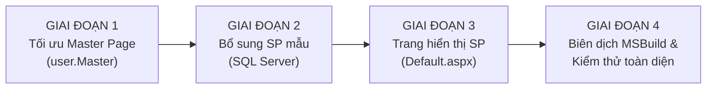

# KẾ HOẠCH CHI TIẾT NÂNG CẤP VÀ HOÀN THIỆN DỰ ÁN WEB BÁN HÀNG
**Học phần:** Lập trình Web (ASP.NET Web Forms + SQL Server)  
**Đề tài:** Hệ thống Web MyPhoneShop (Chapter 2.3 Master Page 3 cột & LINQ to SQL)  
**Ngày cập nhật:** 17/10/2026  

---

## I. TỔNG QUAN & BỐI CẢNH TÁI CẤU TRÚC

### 1. Vấn đề phát hiện (Lỗ hổng nghiệp vụ & Frontend)
* **Sự trùng lặp (Redundancy):** Menu ngang trên Header đã có danh mục các hãng (*iPhone, Samsung, Xiaomi...*), trong khi Cột trái cũng có một khối liệt kê hãng y hệt (*Apple, Samsung, Xiaomi*), gây rối mắt và thừa thãi.
* **Xung đột bộ lọc (Filter Conflict):** Các liên kết ở Cột trái sử dụng link tĩnh độc lập (`?brand=1` và `?price=under5`). Khi người dùng chọn Hãng rồi bấm tiếp chọn Giá thì bị mất điều kiện Hãng đã chọn, không thể lọc kết hợp đa tiêu chí.

### 2. Định hướng giải pháp (Phương án 1 đã thống nhất)
* **Menu Ngang (Top Navigation):** Đảm nhiệm toàn bộ việc **Định vị & Chọn mặt hàng / Thương hiệu** (Menu Cha: *Điện Thoại, Laptop, Bàn Phím*; Menu Con: các hãng tương ứng).
* **Cột Trái (Sidebar):** **Gỡ bỏ khối danh mục hãng bị lặp**, chuyển thành **Bộ lọc Mức giá thông minh (Faceted Filter)** có khả năng cộng dồn tham số trên URL (`cat`, `brand`, `price`) và làm sáng đèn (`active`) mức giá đang chọn.
* **Cơ sở dữ liệu:** Chuẩn hóa bảng `dbo.Menus` còn đúng **5 cột cốt lõi**, loại bỏ các cột nghiệp vụ mở rộng không dùng đến (`Pos`, `UserAdd`, `UserTest`, `Hide`).

---

## II. MA TRẬN 6 LUỒNG NGHIỆP VỤ NGƯỜI DÙNG

| STT | Tên luồng nghiệp vụ | Thao tác người dùng | URL tương ứng sinh ra | Logic lọc CSDL (LINQ to SQL) | Trạng thái hiển thị giao diện (UI) |
| :---: | :--- | :--- | :--- | :--- | :--- |
| **1** | **Mặc định (Trang chủ)** | Vào web hoặc bấm nút *Trang Chủ* | `Default.aspx` | Lấy toàn bộ sản phẩm mới nhất | Nút *Trang Chủ* Active; Cột trái: *Tất cả mức giá* Active; Tiêu đề: "TẤT CẢ SẢN PHẨM" |
| **2** | **Chọn Menu Cha (Loại hàng)** | Bấm Menu Cha: *Điện Thoại* hoặc *Laptop* | `Default.aspx?cat=phone` | Lọc sản phẩm theo ngành hàng | Menu Cha sáng đèn; Cột trái giữ *Tất cả mức giá*; Tiêu đề: "DANH MỤC: ĐIỆN THOẠI" |
| **3** | **Chọn Menu Con (Hãng cụ thể)** | Rê chuột vào *Điện Thoại* $\rightarrow$ chọn *iPhone* | `Default.aspx?cat=phone&brand=1` | Lọc `BrandId == 1` | Menu cha & con sáng; Tiêu đề: "ĐIỆN THOẠI - IPHONE"; Cột trái giữ *Tất cả mức giá* |
| **4** | **Lọc giá từ Trang chủ** | Đang ở Trang chủ, bấm thẳng *Dưới 5 Triệu* | `Default.aspx?price=under5` | Lọc toàn shop `Price < 5,000,000` | Nút *Dưới 5 Triệu* Active; Tiêu đề: "SẢN PHẨM CÓ GIÁ: DƯỚI 5 TRIỆU" |
| **5** | **Lọc kết hợp Hãng + Giá** | Đang xem iPhone $\rightarrow$ Bấm tiếp *Từ 10 - 20 Triệu* | `Default.aspx?cat=phone&brand=1&price=10to20` | Lọc `BrandId == 1 AND (Price BETWEEN 10tr AND 20tr)` | Nút *10 - 20 Triệu* Active; Tiêu đề: "IPHONE - GIÁ TỪ 10 ĐẾN 20 TRIỆU" |
| **6** | **Khôi phục / Bỏ lọc** | Bấm *Tất Cả Mức Giá* ở cột trái | `Default.aspx?cat=phone&brand=1` | Bỏ điều kiện giá, giữ lại hãng đang xem | Nút *Tất Cả Mức Giá* Active lại; Tiêu đề trở về "ĐIỆN THOẠI - IPHONE" |

---

## III. CẤU TRÚC DỮ LIỆU ĐÃ ĐỒNG BỘ VÀO SQL SERVER

### 1. Bảng `dbo.Brand` (8 Hãng toàn hệ thống)
* `1`: Apple (iPhone, MacBook)
* `2`: Samsung
* `3`: Xiaomi
* `4`: Dell
* `5`: Asus
* `6`: Logitech
* `7`: Razer
* `8`: Ducky

### 2. Bảng `dbo.Menus` (5 Cột Tối Giản)
* `ID_MN` (BIGINT, Identity): Khóa chính tự tăng.
* `Parent` (BIGINT): `0` = Menu Cha cấp 1 | `>0` = Menu Con (trỏ về ID cha).
* `Lable` (NVARCHAR(200)): Tên chữ hiển thị trên giao diện.
* `UrlLink` (VARCHAR(200)): Đường dẫn có tham số lọc `cat`, `brand`.
* `OrderKey` (BIGINT): Thứ tự sắp xếp từ trái sang phải.

---

## IV. KẾ HOẠCH THỰC HIỆN 4 GIAI ĐOẠN

### GIAI ĐOẠN 1: Dọn dẹp & Tối ưu Master Page (`user.Master` & `user.Master.cs`)
1. **Gỡ bỏ khối Danh mục Hãng ở Cột trái:**
   * Xóa thẻ `
...<asp:Repeater ID="rptMenuBrands"...>
` khỏi `user.Master`.
   * Gỡ bỏ hàm `LoadMenuBrands()` và các khai báo liên quan trong `user.Master.cs`.
2. **Nâng cấp khối "MỨC GIÁ PHỔ BIẾN" thành Bộ lọc đa năng:**
   * Thêm mục: **"✦ Tất Cả Mức Giá"** (cho phép người dùng xóa lọc giá bất cứ lúc nào).
   * Viết hàm Helper `GetPriceFilterUrl(string priceKey)` trong code-behind để tự động giữ lại `cat` và `brand` trên URL hiện tại khi người dùng click chọn giá.
   * Thêm class CSS `active` làm sáng màu nút giá đang được chọn.

### GIAI ĐOẠN 2: Bổ sung Sản phẩm Mẫu cho Laptop & Bàn Phím
* Viết script T-SQL nạp thêm dữ liệu sản phẩm vào bảng `dbo.Products` để khi click vào Menu con Laptop và Bàn Phím có dữ liệu hiển thị:
  * **Dell (`BrandId = 4`):** Dell Inspiron 15, Dell XPS 13...
  * **Asus (`BrandId = 5`):** Asus TUF Gaming, Asus Zenbook 14...
  * **Logitech (`BrandId = 6`):** Bàn phím Logitech K120, Logitech MX Keys, Logitech G Pro...
  * **Razer (`BrandId = 7`):** Bàn phím cơ Razer BlackWidow V4, Huntsman Mini...
  * **Ducky (`BrandId = 8`):** Bàn phím cơ Ducky One 3 RGB, Ducky One 2...

### GIAI ĐOẠN 3: Hiện thực hóa Trang Sản phẩm (`Default.aspx` & `Default.aspx.cs`)
1. **Frontend `Default.aspx`:**
   * Tạo khối **Tiêu đề & Trạng thái lọc (Breadcrumb / Tag lọc)** tự động hiển thị theo ngữ cảnh đang chọn.
   * Có nút **"✕ Xóa bộ lọc"** khi có điều kiện lọc đang bật.
   * Tạo lưới hiển thị thẻ sản phẩm bằng `<asp:Repeater ID="rptProducts">`: Ảnh sản phẩm, Tên máy, Thương hiệu, Đơn giá định dạng VNĐ (`#,##0 VNĐ`), Nút xem chi tiết / Mua hàng.
   * Khung trạng thái rỗng (Empty state): Thông báo *"Không có sản phẩm nào phù hợp với bộ lọc"* kèm nút *"Xem tất cả"* khi kết quả lọc = 0.
2. **Backend `Default.aspx.cs` (LINQ to SQL):**
   * Đọc `cat`, `brand`, `price` từ `Request.QueryString`.
   * Xây dựng câu truy vấn lọc kết hợp động:
     * Lọc theo `brand` (nếu có).
     * Lọc theo `price`: `< 5tr`, `5 - 10tr`, `10 - 20tr`, `> 20tr`.
     * Lọc theo `cat` (nếu chỉ bấm nhóm hàng chung).
   * Đổ dữ liệu vào `rptProducts` và gán tiêu đề tương ứng.

### GIAI ĐOẠN 4: Biên dịch, Kiểm thử & Bàn giao
1. Dùng `MSBuild.exe` biên dịch toàn bộ Solution: Cam kết đạt **0 Errors, 0 Warnings**.
2. Kiểm tra trực quan từng luồng nghiệp vụ trên trình duyệt:
   * Chạy Trang chủ mặc định.
   * Chọn Menu con Điện thoại, Laptop, Bàn phím.
   * Thử lọc giá độc lập và lọc giá kết hợp với Hãng.
   * Thử nút "Tất Cả Mức Giá" và nút "Xóa bộ lọc".
